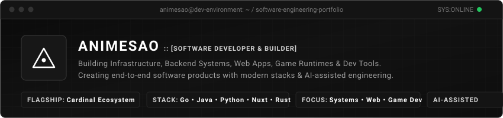

<div align="center">



<br/>

[](https://github.com/animesao)
[](https://github.com/animesao/cardinal)
[](https://github.com/animesao)
[](https://github.com/animesao)

<br/>

```text
animesao@core:~$ whoami --verbose
Systems & Infrastructure Developer.
Building daemonless container runtimes, Linux kernel tooling, and developer ecosystems.
```

</div>

---

### ⚡ System Overview

I design and build systems software, container runtimes, and developer tooling. My work centers on **lean, daemonless architectures**, eliminating heavy background daemons in favor of direct Linux kernel primitives.

I treat **AI as a core engineering multiplier** — utilizing state-of-the-art models as interactive pair-architects for protocol design, concurrency edge-case analysis, test generation, and continuous refactoring.

- 🔭 **Flagship Project:** [Cardinal](https://github.com/animesao/cardinal) — lightweight daemonless OCI container runtime in Go (~5 MB static binary).
- ⚙️ **Core Focus:** Linux kernel isolation (namespaces, cgroups v2, TC/eBPF), runtime design, and reactive control planes.
- 💡 **Engineering Philosophy:** First-principles architecture, single-binary distribution, zero background bloat, and self-hosted autonomy.

---

### 🌐 Flagship Ecosystem: Cardinal

**[Cardinal](https://github.com/animesao/cardinal)** is an open-source, daemonless container ecosystem created from scratch. It is engineered as a fast, resource-efficient alternative to Docker for servers, microservices, and dedicated game infrastructure.

```text
┌──────────────────────────────────────────────────────────────────────────┐
│                           CARDINAL ECOSYSTEM                             │
└──────────────────────────────────────────────────────────────────────────┘
                                      │
                                      ▼
       [ Web Browser / Client ] ──► [ Cardinal Panel ]
                                    • Nuxt 4 + Vue 3 + Tailwind CSS
                                    • Drizzle ORM + SQLite / MySQL
                                           │
                                           │ HTTP REST / WebSockets (Role-based Tokens)
                                           ▼
                                 [ Cardinal Wings Daemon ]
                                    • Lightweight Go management daemon
                                    • Live log streaming & interactive PTY exec
                                           │
                                           │ Local CLI / Direct Process Control
                                           ▼
                                   [ Cardinal Runtime ]
                                    • ~5 MB static Go binary (no dockerd required)
                                    • OCI image pulling, rootfs extraction & layering
                                           │
                           ┌───────────────┴───────────────┐
                           ▼                               ▼
                 [ Linux Namespaces ]            [ Network Bridge ]
                 • cgroups v2 (CPU / Mem limits) • Custom veth pairs + NAT
                 • pivot_root container rootfs   • Dynamic port forwarding
```

#### Core Components

| Component | Repository | Role | Tech Stack | Status |
| :--- | :--- | :--- | :--- | :--- |
| **Cardinal** | [`animesao/cardinal`](https://github.com/animesao/cardinal) | Daemonless container engine (~5 MB binary, OCI pull, cgroups v2, bridge network) | `Go` `OCI` `Linux Kernel` | `v2.4.14` |
| **Cardinal Wings** | [`animesao/cardinal-wings`](https://github.com/animesao/cardinal-wings) | Secure HTTP REST agent for remote node management, RBAC, live streaming & exec | `Go` `REST API` `WebSockets` | `v1.0 Live` |
| **Cardinal Panel** | [`animesao/cardinal-panel`](https://github.com/animesao/cardinal-panel) | Web control plane for orchestrating nodes, servers, file management & metrics | `Nuxt 4` `Vue` `Drizzle ORM` | `v0.6.4` |

---

### 📂 Featured Open Source Repositories

- **[cardinal](https://github.com/animesao/cardinal)** — *Lightweight Container Runtime.*  
  No daemon, no Docker, just containers. ~5 MB static binary supporting OCI images, bridge networking, cgroups v2 resource quotas, multi-container configs, and cluster mode.  
  `Go` `Linux Namespaces` `cgroups v2` `OCI` `systemd`

- **[cardinal-wings](https://github.com/animesao/cardinal-wings)** — *HTTP Control-Plane Agent for Cardinal.*  
  Production REST API daemon bridging web dashboards to Cardinal nodes. Provides multi-key role-based access (admin/read-only), log following, and interactive PTY execution.  
  `Go` `REST API` `WebSockets` `Security`

- **[cardinal-panel](https://github.com/animesao/cardinal-panel)** — *Server Management Web Dashboard.*  
  Modern full-stack control panel for managing game servers and containerized workloads across Cardinal nodes at runtime. Features live console, file manager, and metrics.  
  `Nuxt 4` `Vue.js` `Drizzle ORM` `SQLite`

- **[veilnet](https://github.com/animesao/veilnet)** — *Kernel-Level Traffic Interception & DPI Bypass.*  
  Linux kernel-space network utility built with Traffic Control (TC) and eBPF. Features flexible per-IP, subnet, and domain filtering as a native Linux alternative to WinDivert/zapret.  
  `Rust` `C` `eBPF` `Linux TC`

- **[ScriptsLab](https://github.com/animesao/ScriptsLab)** — *JavaScript Scripting Engine for Minecraft Paper.*  
  Production-grade plugin framework enabling server admins to script gameplay features in modern JavaScript with full access to the Bukkit/Paper API via GraalVM Polyglot.  
  `Java 17+` `GraalVM` `PaperMC` `JavaScript`

- **[rem-bg](https://github.com/animesao/rem-bg)** — *Local Offline Background Remover.*  
  Desktop application for offline batch image background removal. Runs neural segmentation locally on your workstation without cloud dependencies or telemetry.  
  `Python` `Computer Vision` `Desktop UI` `Local AI`

---

### 🛠️ Technical Stack & Toolkit

```text
[SYSTEMS & BACKEND]   Go (Primary) • Rust • Java • Python • Bash
[KERNEL & RUNTIME]    Linux (Arch Linux) • Namespaces • cgroups v2 • eBPF • TC • OCI Spec
[FRONTEND & CLIENT]   Nuxt 4 • Vue.js • TypeScript • Tailwind CSS • Vite
[STORAGE & DATA]      SQLite • MySQL / MariaDB • PostgreSQL • Drizzle ORM • Redis
[INFRA & TOOLING]     systemd • Git • GitHub Actions • pnpm • GraalVM • Niri / Hyprland
```

#### Competency Breakdown

- **Systems & Containers (Production):**
  - Statically compiled binaries with minimal footprint (`Go`).
  - Kernel isolation primitives: mount, pid, net, ipc namespaces, and cgroups v2 controllers.
  - Linux networking: virtual ethernet (`veth`) pairs, bridge interfaces, iptables/nftables NAT rules.
  - eBPF and Traffic Control (`cls_bpf`) for kernel-level packet manipulation (`Rust`, `C`).

- **Backend & Application Engineering (Production):**
  - RESTful API architecture, role-based authorization tokens, and WebSocket streaming (`Go`, `Node.js`).
  - High-performance server scripting and sandboxed execution via `GraalVM` Polyglot (`Java`).
  - Desktop automation and local neural network pipelines (`Python`).

- **Web & Interface Development (Production):**
  - Server-side rendered and single-page applications using `Nuxt 4` and `Vue 3`.
  - Type-safe data layers with `Drizzle ORM` over `SQLite` and relational engines.

- **Active Research & Exploration:**
  - *Declarative Linux:* Reproducible environment builds with `NixOS`, `Nix Flakes`, and `Home Manager`.
  - *Local AI Inference:* Self-hosted model runtimes, quantized inference (`llama.cpp`, `Ollama`), and RAG pipelines.

---

### 🤖 AI-Assisted Engineering Workflow

I integrate frontier AI models into my daily engineering cycle not as an autocomplete shortcut, but as an interactive pair-architect:

1. **System & Protocol Design:** Iterating on API contracts, state machines, and concurrency models to surface race conditions and edge cases prior to implementation.
2. **Implementation Scaffolding:** Generating boilerplates, CLI parser structures, and low-level syscall wrappers with rigorous human oversight.
3. **Correctness & Invariant Validation:** Synthesizing property-based test suites, fuzz testing harnesses, and verifying boundary conditions.
4. **Refactoring & Code Modernization:** Performing architectural refactoring, keeping codebases idiomatic, and trimming redundant abstractions.

---

### 📊 Repository Activity

<div align="center">


</div>

---

### 🔗 Connect & Verification

<div align="center">

[](https://cardinal.work.gd/)
[](https://github.com/animesao)
[](https://github.com/animesao/cardinal)
[](https://github.com/animesao)

<br/>

```text
Public Identity: animesao // Open-Source Infrastructure & Runtime Research
```

</div>
